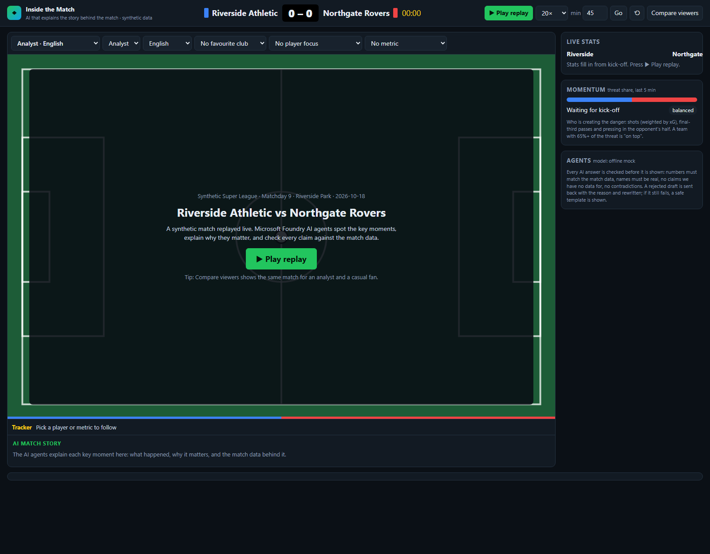
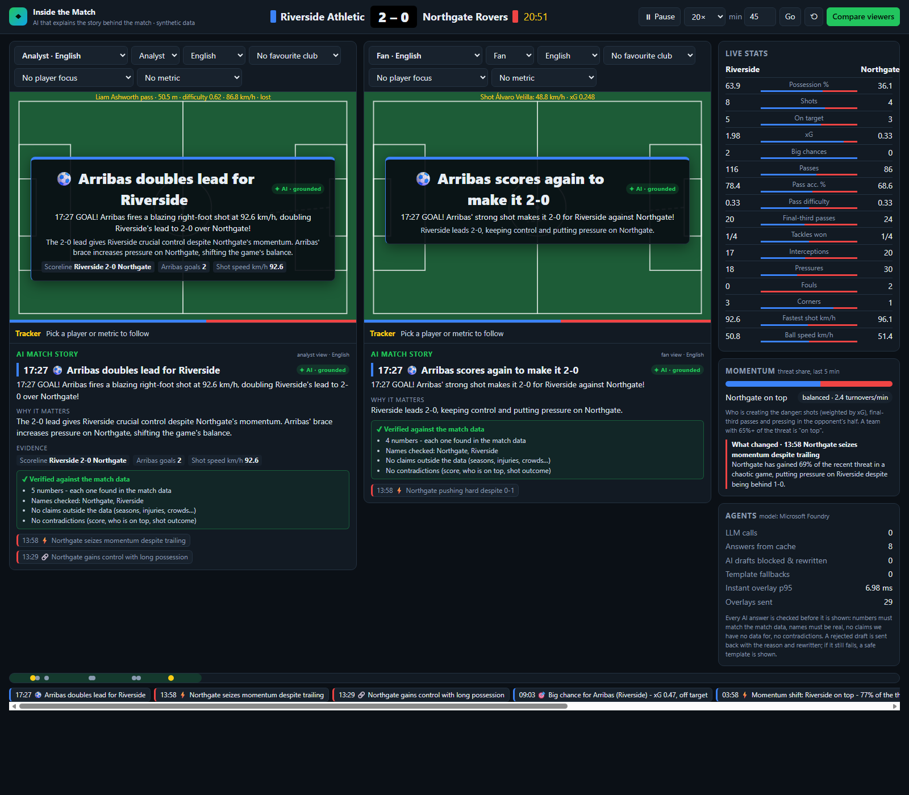
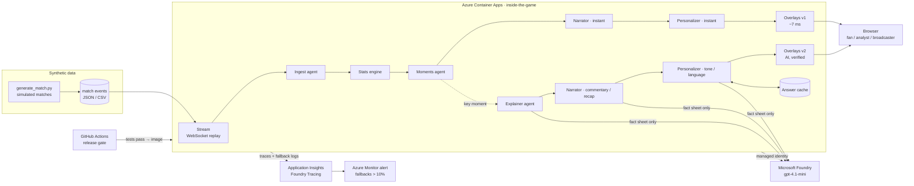
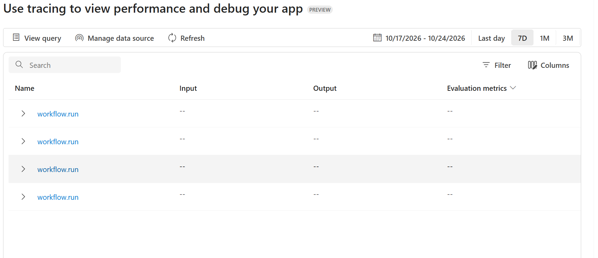
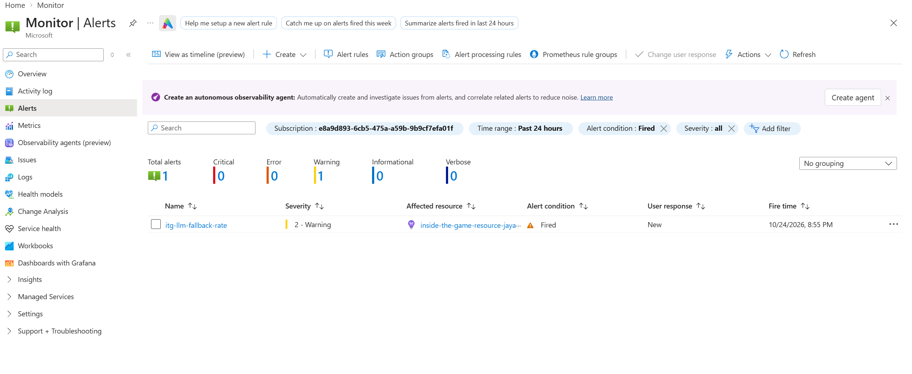
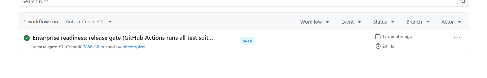

# Inside the Game: match intelligence that explains itself

**Synthetic football events in → explained key moments, live commentary and recaps out, personalised for every fan, analyst and broadcaster.**
Built with **Microsoft Foundry**, **Microsoft Agent Framework** and **Azure Container Apps**.

**▶ Live demo:** https://inside-the-game.delightfulsand-21c23dc9.eastus2.azurecontainerapps.io/ (press *Play replay*; first load after idle takes ~20 s)
**🎬 Video (< 2 min):** _link to be added_



---

## What it does
One pipeline, five stages, running on a simulated match as if it were live:

| Stage | What happens | Where |
|---|---|---|
| **a. Ingest** | Synthetic events stream in real time; malformed and duplicate events are rejected | `stream_server.py`, Ingest agent |
| **b. Interpret** | Live stats: possession, xG, pass difficulty, ball/shot speed, momentum, pressure spells, game rhythm | `stats_engine.py`, [docs/metrics.md](docs/metrics.md) |
| **c. Explain** | Key moments ranked by importance; AI agents explain *why* they matter (control vs chaos, pressure, momentum) | Moments + Explainer agents |
| **d. Render** | Timed, machine-readable overlays (JSON) on a broadcast-style screen: instant first, AI version seconds later | `app.py`, `static/` |
| **e. Personalise** | Same match, different experience: mode, language, favourite club, player focus, single metric | Personalizer agent |

**Three audiences, one feed**
- **Fan:** fewer, bigger moments, fan tone, own club highlighted, in their language.
- **Analyst:** every moment, the numbers behind it, a "Verified" box listing which checks passed.
- **Broadcaster:** an on-air caption, a sentence to read, and a talking point.

**6 languages:** English, Español, Français, Português, हिन्दी, العربية (player and team names kept in Latin letters).
**Presets:** Analyst, Fan, Broadcaster, Spanish fan of the away club, Player focus, Hindi fan of the home club. Or build your own viewer.



---

## Architecture



- **Live workflow** (every event, no AI, ~7 ms): Ingest → Stats → Moments → Narrator → Personalizer. The viewer never waits for a model.
- **Enrichment workflow** (each key moment, in the background): Explainer → Narrator → Personalizer call Foundry with a fact sheet only. The verified AI version replaces the instant overlay.
- **Recap workflow** (half-time, full-time): Narrator → Personalizer.

---

## Microsoft technology used
| Technology | What it does here |
|---|---|
| **Microsoft Foundry** | Hosts the model (`gpt-4.1-mini`); model swap by deployment name; default content filter (DefaultV2); model monitor (requests, tokens, cost); **Tracing** of every agent and model call; **Groundedness evaluator** (98% of answers grounded) |
| **Microsoft Agent Framework** | Three workflows (`WorkflowBuilder`) with typed handoffs between 6 agents; built-in Foundry chat client; OpenTelemetry spans |
| **Azure Container Apps** | Hosts the whole live pipeline and UI; scale to zero; system-assigned managed identity |
| **Microsoft Entra ID** | No API keys anywhere: `az login` locally, managed identity + "Foundry User" role in Azure |
| **Application Insights + Azure Monitor** | Agent traces, one log per model answer, alert when more than 10% of answers fall back to templates |
| **GitHub Actions** | Release gate: 4 test suites must pass before the container image builds |

---

## Multi-agent design
| Agent | Kind | Role |
|---|---|---|
| **Ingest** | rules | Rejects malformed and duplicate events |
| **Stats** | deterministic | Live state, pass quality, speed, momentum, rhythm, alerts |
| **Moments** | rules | Ranks alerts into key moments (importance 0–100); decides what deserves an AI explanation |
| **Explainer** | AI (Foundry) | Explains *why* a moment matters, from a fact sheet only |
| **Narrator** | template + AI | Instant line, broadcast commentary, half-time and full-time recaps |
| **Personalizer** | rules + AI | Rules decide *what* each viewer sees; AI changes *how* it reads (tone, language) |

- **Shared state:** `MatchContext` (stats engine, key moments, viewer profiles, model metrics).
- **Handoffs:** typed messages (`StatsUpdate → MomentBatch → OverlayBatch`, `EnrichRequest → Explained → Narrated`).
- **Failure recovery:** every AI step has a timeout, a retry *with feedback on why the answer was rejected*, and a template fallback.

**How the agents collaborate**
1. **Moments decides who works:** it ranks every alert and sends only moments with importance ≥ 45 to the Explainer, so AI effort goes where it matters (~21 per match).
2. **Each agent builds on the last:** the Explainer's *why* becomes the Narrator's commentary; the Narrator's line becomes the Personalizer's fan, analyst or broadcaster version in the viewer's language.
3. **Draft → check → rewrite loop:** every AI draft goes to the grounding check. A rejected draft goes back to the same agent *with the reason*
   (e.g. "numbers not in the facts: [20.0]", "claims that contradict the data: Riverside are not on top"), and the agent rewrites it.
   With the real model, 2–3 drafts per match are rejected and fixed this way ([docs/real_model_findings.md](docs/real_model_findings.md)).
4. **Instant and AI paths work together:** the live workflow puts a template on screen in ~7 ms; the enrichment workflow replaces it with the verified AI version.
   If an AI agent fails, the instant overlay simply stays.
5. **Shared answers:** every agent's verified answers are cached per model, so viewers with the same profile reuse them (0 extra model calls).

**What one agent couldn't do:** numbers come from deterministic code, meaning from the Explainer, voice from the Narrator, audience fit from the Personalizer, and each draft is checked before the next agent uses it.

**Why multi-agent: measured** against a single agent with the same facts, moments, viewers and checks (41 overlays, real Foundry model, `eval_single_agent.py`):

| | Multi-agent | Single agent | Single agent + retry |
|---|---|---|---|
| Viewer sees the moment after (p95) | **4.7 ms** | 3.2 s | 4.2 s |
| Answers still wrong after the checks | **0** | 11 | 1 |
| Tokens per moment, 3 → 50 → 200 viewer profiles | 3.2K → 23K → 86K | 2.5K → 42K → 168K | 3.3K → 55K → 222K |

A single agent can match on correctness only with a retry, and then every viewer waits ~4 s and it costs more from ~3 viewer profiles
(2.6x at broadcast scale): the shared Explainer + Narrator work is paid once per moment, not once per viewer. Details: [docs/agents.md](docs/agents.md#single-agent-vs-multi-agent-measured)

Details: [docs/agents.md](docs/agents.md) · data formats: [docs/schemas.md](docs/schemas.md)

---

## Trust: how we know the AI tells the truth
1. **Fact sheet only:** the model sees computed stats for the moment, nothing else. Numbers never come from the model.
2. **Grounding checks on every answer:** rejected if it contains a number not in the facts, an unknown name, an out-of-scope topic
   (season, injury, transfer…) or a claim that contradicts the data ("leads" while trailing, "on top" against the momentum).
3. **Retry with feedback, then template fallback:** an unverified answer never reaches the screen.
4. **Labelled on screen:** every overlay shows **✦ AI · grounded**, **● LIVE** (instant template) or **● AUTO** (fallback).

| Result | Value | Source |
|---|---|---|
| AI answers that passed every check (real model, 2 matches) | **100%** | [docs/real_model_findings.md](docs/real_model_findings.md) |
| Foundry Groundedness evaluator over all 329 saved answers | **321/329 grounded (98%)**, avg 4.82/5 | [docs/groundedness_report.md](docs/groundedness_report.md) |
| Overlays lost when the model was too slow (gpt-5-mini, 44 timeouts) | **0** | [docs/model_comparison.md](docs/model_comparison.md) |
| Instant overlay latency (p95) | **~7 ms** | `test_agents.py` |
| Contradictions caught on the test set / false alarms | **9/9 / 0** | `test_agents.py` check 21 |
| Model calls per viewer on the live app: preset (cached) vs custom profile | **0** (59–76 cache hits) vs 16 | RUNBOOK §7, `test_app.py` checks 11–13 |

| Foundry Tracing | Fallback-rate alert fired | Release gate |
|---|---|---|
|  |  |  |

---

## Enterprise readiness
- **Reliability:** template first, AI second; no overlay ever lost; 0 workflow errors in every test run.
- **Transparency:** on-screen AI labels and a "Verified" box; [model card](docs/model_card.md); Foundry tracing.
- **Controls:** no keys (Entra ID), content filter, grounding rules, fallback-rate alert, budget alerts, CI release gate.
- **Cost:** about ₹0.03 per model call; preset viewers cost **0** model calls (answers cached); a custom viewer is about ₹0.5 per match.
- **Path to adoption:** pilot on a partner's replays → live second screen for one competition → league-wide rollout.

Full story (buyers, adoption path, cost, AI label policy, scale): [docs/enterprise_readiness.md](docs/enterprise_readiness.md)

---

## Run it locally
1. Python 3.13. From the project root:
   ```powershell
   python -m venv .venv
   .\.venv\Scripts\Activate.ps1
   pip install -r requirements.txt
   ```
2. Copy `.env.example` to `.env`. The default `LLM_PROVIDER=mock` runs fully offline and free.
3. Start the app and open http://localhost:8600, then press **Play replay**:
   ```powershell
   python app.py
   ```
4. Run the tests (mock model, no Azure):
   ```powershell
   python test_stats.py
   python stream_server.py      # in a second terminal, then:
   python test_stream.py --check
   python test_agents.py
   python test_app.py
   ```
5. **With Microsoft Foundry:** set `LLM_PROVIDER=foundry`, `FOUNDRY_PROJECT_ENDPOINT` and `FOUNDRY_MODEL` in `.env`, run `az login`, then
   `python test_agents.py --foundry`. Add `TRACING=1` to see traces in Foundry; `--model <deployment>` to try another model.
6. **Generate your own match:** `python generate_match.py match_002`, then `python validate_match.py match_002`.

Every command, deploy step and test result: [RUNBOOK.md](RUNBOOK.md)

---

## Repository map
| Path | What |
|---|---|
| `generate_match.py`, `metrics.py`, `validate_match.py` | Synthetic match simulator, xG and pass-difficulty formulas, consistency checks |
| `data/synthetic/` | Two generated matches (~2,000 events each, JSON + CSV) |
| `stream_server.py` | Replays a match as a live WebSocket feed |
| `stats_engine.py` | Real-time statistics, patterns and alerts |
| `orchestrator.py`, `agents/` | Agent Framework workflows and the 6 agents |
| `llm.py` | Foundry client (or offline mock), tracing setup |
| `app.py`, `static/` | Web app: one replay per viewer, overlays, presets |
| `prebake_cache.py`, `data/cache/answers.json` | Verified answers for the presets (0 model calls for judges) |
| `eval_groundedness.py` | Foundry Groundedness evaluator over every saved answer |
| `eval_single_agent.py` | Single agent vs multi-agent on the real model (quality, latency, tokens as viewers grow) |
| `test_*.py`, `logs/` | Test suites and their saved results |
| `Dockerfile`, `.github/workflows/` | Container image and release gate |
| `docs/` | Agents, metrics, schemas, findings, model card, enterprise readiness |

---

## Data and credits
- **All match data is synthetic**, generated by `generate_match.py`: football-realistic events, made-up clubs and players. No real league data is used or published.
- The public Metrica Sports sample data was used **for development testing only** (`metrica_adapter.py`); it is not included in this repo.
- No league or club trademarks are used.

## Limits and future work
- **Synthetic data only** (hackathon rule). The adapter pattern (`metrica_adapter.py`) is the path to a partner's real event feed.
- **Auto-eventing:** a vision model over the video feed to produce pass and speed metrics automatically (not built).
- **Scale:** one replica and up to 5 viewers at once is a budget setting; the answer cache would move to Redis for more replicas.
- **One region** (East US 2); a partner deployment would use their own region and Foundry project.
- **Groundedness evaluator** runs offline today; next, sample live answers each match.
